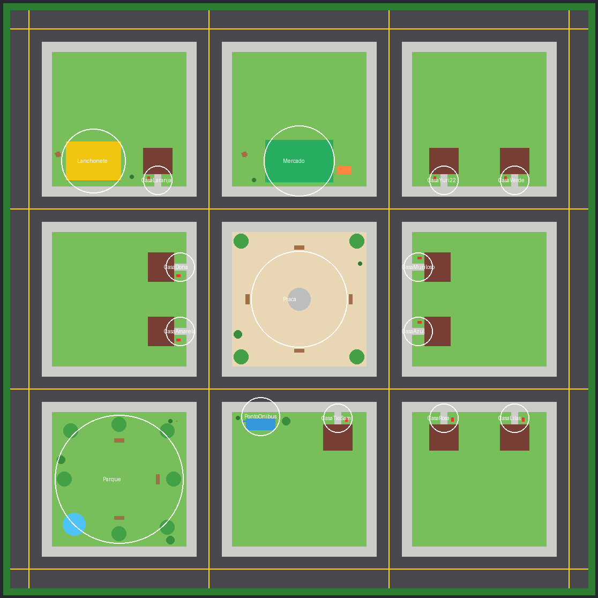

# MEU VIZINHO É UM NPC — YURI22 & AMIGOS

Jogo social de dedução para Roblox. O bairro é habitado por Yuri22, Dona, Muriloso, Tio Sam e
outros moradores. Em cada partida, alguns moradores são NPCs controlados pelo servidor e outros
são jogadores reais disfarçados. Ninguém sabe quem é quem até a revelação no fim da rodada.



## Estado atual: Fase 1 (fundação jogável)

| Fase | Conteúdo | Situação |
|---|---|---|
| 1 | Estrutura, mapa, lobby, rodadas, personagens provisórios, NPCs com rotina, jogadores disfarçados, primeiras missões, condição de vitória | **Implementada** |
| 2 | Papéis secretos (Investigador, Imitador, Morador), diálogos contextuais, memória de sessão, pistas, suspeita e votação | Aguardando confirmação |
| 3 | Interface completa (tela inicial, tutorial, loja, configurações), eventos aleatórios, áudio, emotes, progressão | — |
| 4 | DataStoreService, tratamento de falhas, limites e proteção extra | — |
| 5 | Testes multiplayer, celular, otimização e publicação | — |

**Como a Fase 1 foi verificada:** não existe Roblox Studio neste ambiente (Linux), então o jogo
**não foi executado no Studio**. O que foi feito:

- type-check estrito (`--!strict`) de todos os scripts com o `luau-lsp` e as definições atuais da API do Roblox (pega propriedade, método ou enum inexistente e APIs obsoletas);
- 21 testes automáticos da lógica pura (missões, rotina dos NPCs, sorteio da partida) e da coerência das configurações, rodando com Lune;
- o gerador do mapa roda de verdade fora do Studio (Lune) e um teste confere que nenhum NPC para dentro de um obstáculo, que nenhum objeto interativo está enterrado e que as casas não invadem a rua;
- build do arquivo de place com Rojo.

O checklist de testes no Studio está em [docs/TESTES.md](docs/TESTES.md).

## Como jogar a Fase 1

1. Todos entram no **lobby** (plataforma flutuante). Com jogadores suficientes (`GameConfig.MinPlayers`), começa a contagem.
2. Cada jogador vira um **morador** do bairro (mesma aparência, nome, velocidade e prompt de conversa que o NPC daquele morador teria). Os moradores restantes viram **NPCs** que seguem rotinas.
3. Cada jogador recebe **3 missões secretas** (só ele vê): visitar lugares, rondar casas, conversar com moradores, entregar uma encomenda, achar um objeto perdido, seguir alguém discretamente.
4. A rodada termina quando **todas as missões foram resolvidas** ou quando o **tempo acaba** (7 min por padrão).
5. **Vitória:** concluir todas as suas missões. Resultado mostra suas missões, as **Fichas do Bairro** ganhas e **quem era jogador e quem era NPC**.
6. Todos voltam ao lobby e a próxima partida começa.

## Instalação

### Opção A — abrir o place pronto (mais simples)
1. Baixe `build/MeuVizinhoEUmNPC.rbxlx` e abra no Roblox Studio (File > Open from File).
2. Se o lugar estiver publicado: Game Settings > Avatar > **Avatar Type = R15**.
3. Aperte **Play**. O mapa é gerado pelo servidor ao iniciar (no modo de edição o Workspace fica vazio; isso é esperado).

### Opção B — Rojo (recomendado para continuar desenvolvendo)
1. Instale as ferramentas fixadas em `rokit.toml` (`rokit install`) ou o [Rojo 7.6](https://rojo.space).
2. `rojo serve` na raiz do repositório e conecte pelo plugin do Rojo no Studio.
3. Para gerar o place: `rojo build default.project.json -o build/MeuVizinhoEUmNPC.rbxlx`.

### Opção C — copiar e colar no Studio
Crie cada objeto com o nome e tipo exatos e cole o conteúdo do arquivo. A tabela completa, com
local, tipo, dependências e como verificar cada arquivo, está em [docs/ARQUIVOS.md](docs/ARQUIVOS.md).
Regra de nomes do Rojo: `Nome.server.luau` = Script, `Nome.client.luau` = LocalScript,
`Nome.luau` = ModuleScript, pasta = Folder. Se partir do template Baseplate, **apague o
`SpawnLocation` do template**, senão jogadores podem nascer no meio da praça.

## Arquitetura

Servidor autoritativo, módulos pequenos com uma responsabilidade cada, inicializados em ordem
por um único `Bootstrap`. A lógica que dá para testar fora do Roblox fica separada em `Logic/`.

```
Bootstrap.server ──> EconomyService ─ MapService ─ CharacterService ─ InteractionService ─ RoundService
                                                                                        │
RoundService ──> MatchSetup (sorteios)      NPCService ──> RoutinePlanner (decide o próximo destino)
             ──> NPCService                 MissionService ──> MissionLogic (gera/avança missões)
             ──> MissionService ──> Remotes (FireClient só para o dono)
             ──> CharacterService (disfarce)   InteractionService ──> MissionService / NPCService / RoundService
             ──> EconomyService (fichas no fim)
Cliente: ClientBootstrap ──> UIController, MissionController, InteractionController (só apresentação)
```

### Estrutura no Studio

```
ReplicatedStorage
├── Shared (Folder)
│   ├── Config (Folder)
│   │   ├── GameConfig        regras da partida (tempos, limites, recompensas)
│   │   ├── CharacterConfig   moradores: aparência, personalidade, rotina, falas, pistas, missões
│   │   ├── RoutineConfig     rotinas dos NPCs (sequência, variações, durações)
│   │   ├── MissionConfig     modelos de missão
│   │   ├── MapConfig         layout do bairro (POIs, casas, esconderijos, lobby)
│   │   └── AssetConfig       IDs de animação (áudio entra na Fase 3)
│   ├── Remotes               cria/acessa os RemoteEvents
│   └── Types                 tipos dos dados que passam pela rede
├── Remotes (Folder, criado em runtime)   Notify, PlayerState, MissionUpdate, RoundResult, GetPlayerState
└── GameState (Folder, criado em runtime) atributos Phase e PhaseEndsAt
ServerScriptService
├── Bootstrap (Script)
├── Logic (Folder)       MatchSetup, RoutinePlanner, MissionLogic        (lógica pura, testável)
└── Services (Folder)    EconomyService, MapService, CharacterService, NPCService,
                         MissionService, InteractionService, RoundService
ServerStorage
└── NPCModels (Folder, criado em runtime) modelos-base dos NPCs, clonados a cada rodada
StarterPlayer > StarterPlayerScripts
├── ClientBootstrap (LocalScript)
├── Controllers (Folder) UIController, MissionController, InteractionController
└── UI (Folder)          UIKit
Workspace (tudo criado em runtime)
├── Lobby        plataforma, SpawnLocation, letreiro
├── ActiveMap    ruas, quarteirões, casas, praça, mercado, lanchonete, parque, ponto de ônibus, esconderijos
└── Residents    NPCs da rodada
PlayerGui (criado pelo cliente): MainUI, MissionUI, ResultsUI
```

Ajustes em relação à estrutura sugerida: `GameService` virou parte do `RoundService` (seria só
uma camada a mais); a interface é criada por código em vez de ScreenGuis montados à mão no
StarterGui (dá para versionar e instalar sem montar nada); `DialogueService`, `RoleService`,
`SuspicionService`, `VotingService`, `EventService`, `DataService` e `NPCBrainService`
(memória/estados avançados) entram nas fases em que são usados, para não entregar módulos vazios.

## Decisões técnicas

- **Sem remotes de ação.** Toda ação de jogo (conversar, procurar, retirar e entregar encomenda) é um `ProximityPrompt` criado pelo servidor e validado no `InteractionService` (fase da partida, participante, vivo, distância máxima, limite de frequência, cooldown por alvo). O único remote cliente → servidor é `GetPlayerState`, somente leitura e com limite de frequência. Não existe caminho para o cliente dar fichas, concluir missão ou escolher papel.
- **Disfarce justo.** Jogador e NPC do mesmo morador usam o mesmo `HumanoidDescription`, o mesmo nome, a mesma `WalkSpeed`, o mesmo prompt "Conversar", o mesmo grupo de colisão e as mesmas animações R15 padrão. O botão de reset é desligado (um morador que "morre" seria pista). Nada de barra de "chance de ser NPC".
- **Segredos só no servidor.** Quem é jogador, quais missões cada um tem e onde está o objeto perdido nunca vão para outros clientes; cada jogador recebe só os próprios dados por `FireClient`. A revelação só acontece no `RoundResult`.
- **Missões à prova de repetição.** Uma missão só avança enquanto está `Active`; ao concluir, falhar ou ser cancelada ela congela. As fichas são pagas uma única vez por rodada com a chave `round:<id>` no `EconomyService`.
- **IA simulada, sem API externa.** `RoutinePlanner` decide destinos a partir da rotina, personalidade (pontualidade, energia) e contexto, com variações, atrasos e retorno para casa no fim da rodada; `NPCService` executa com `PathfindingService` (preferindo calçadas), tentativas limitadas, pontos de parada alternativos e teleporte de emergência só quando nenhum jogador está olhando.
- **Desempenho.** Uma thread por NPC que passa a maior parte do tempo dormindo; NPCs longe de todos os jogadores verificam o movimento 5x menos; física dos NPCs fica no servidor; modelos-base são gerados uma vez e clonados; a rodada usa um único loop de 0,5 s.
- **Seed por partida.** Cada rodada sorteia uma seed (aparece no Output). `GameConfig.FixedSeed` repete exatamente a mesma distribuição para depurar.
- **Sem assets inventados.** Só são usados os IDs das animações R15 padrão da própria Roblox; tudo o mais é geometria e interface nativas. Se uma animação não carregar, o NPC só anda sem animação.

## Limitações conhecidas (honestas)

- **Não testado no Studio por mim.** Os pontos que só o motor do Roblox confirma estão listados no topo de [docs/TESTES.md](docs/TESTES.md).
- **Clientes modificados** (exploits) sempre conseguem descobrir quais modelos pertencem a jogadores (`Players:GetPlayerFromCharacter`). É uma limitação do Roblox; jogadores comuns não têm acesso a isso. Os segredos que importam (missões, papéis na Fase 2, votos) continuam só no servidor.
- **Chat e passos denunciam jogadores** na Fase 1: o balão de chat aparece sobre o morador e os sons de passos padrão só existem em personagens de jogadores. A Fase 2 faz os NPCs falarem em balões e mascara o nome no chat; a Fase 3 iguala os sons.
- **Aparência provisória** dos quatro principais até as imagens de referência chegarem (ver `CharacterConfig`).
- **Fichas não são salvas** entre sessões até a Fase 4 (ficam no leaderstats durante a sessão).

## Testes automáticos

Ferramentas fixadas em `rokit.toml` (Rojo 7.6.1, Lune 0.10.4, luau-lsp 1.60.0). Comandos em
[docs/TESTES.md](docs/TESTES.md).
